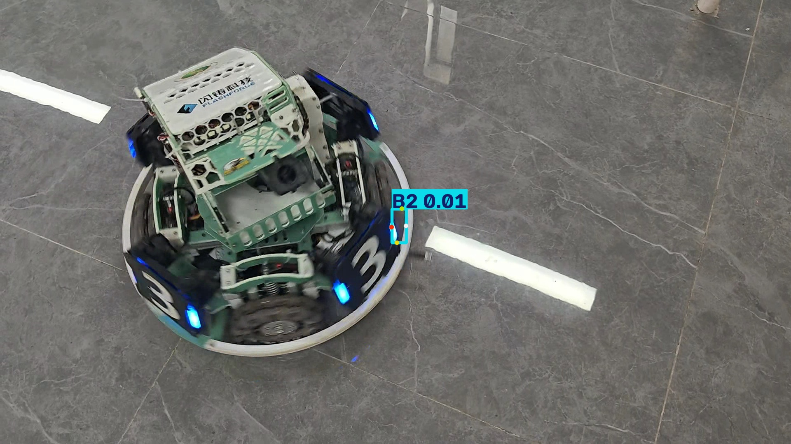

# YOLO 模型导出、推理与性能对比

## 1. 模型版本
YOLO26n-pose（Ultralytics 8.4.177 训练的自定义姿态估计模型，129 层，2,447,934 参数）

## 2. 导出格式与方法
导出为 ONNX 格式，使用 export.py：

```python
from ultralytics import YOLO
model = YOLO("models/model.pt")
model.export(format="onnx", imgsz=640)
```

## 3. 运行环境与依赖
- Python 3.14.4 / PyTorch 2.14.1+cpu / Ultralytics 8.4.177 / ONNX Runtime 1.31.0
- 硬件：ARM64 CPU（虚拟机环境）
- 依赖见 requirements.txt

## 4. 推理运行命令
```bash
python3 inference.py
# 或使用命令行：
yolo predict task=pose model=models/model.onnx source=frame_02.jpg imgsz=640 conf=0.01 save=True
```

## 5. 推理结果截图
| ONNX 模型 | 原始 .pt 模型 |
|---|---|
|  |  |

## 6. 性能对比

| 对比项目 | 原始 .pt 模型 | 导出 ONNX 模型 |
|---|---|---|
| 模型格式 | .pt | .onnx |
| 模型文件大小 | 5.6 MB (5,892,455 字节) | 9.7 MB (10,196,336 字节) |
| 推理耗时（20 次平均） | 58.7 ms/张 | 61.1 ms/张 |
| 检测目标数量 | 1 个（B2） | 1 个（B2） |
| 检测效果 | 见 results/pt_result.jpg | 见 results/onnx_result.jpg |

（单次推理明细示例：ONNX 预处理 3.4ms + 推理 52.5ms + 后处理 4.3ms）

## 7. 遇到的问题及解决方法
1. PEP 668 系统包保护报错：Ubuntu 禁止直接 pip 装包，改用 `pip install --user --break-system-packages` 安装到用户目录。
2. 导出时报 ModuleNotFoundError: onnx：安装 onnx 包后重新导出成功。
3. `yolo val` 报错 shape '[-1,17,3]' invalid：默认 coco8-pose 数据集是 17 关键点格式，与自训练模型的关键点数不匹配，且本地无验证数据集，故改用行为一致性验证代替 mAP 对比。
4. 默认 conf=0.25 时 no detections：测试图片与训练场景有差异，置信度低于 0.25，将阈值调至 0.01 后成功检出。

## 8. 理解与结论
- 纯 CPU 环境下 .pt 与 .onnx 推理速度基本持平（差异约 4%，属正常波动），且检出结果完全一致，说明 ONNX 导出是无损转换。
- ONNX 的价值在部署层面：推理只需轻量的 onnxruntime，无需完整 PyTorch 环境，便于跨平台部署；它也是向 TensorRT（GPU 约 2~5 倍加速）、OpenVINO（Intel CPU 约 3 倍加速）转换的标准中间格式。
- .pt 适合训练和实验，ONNX 等导出格式适合实际部署。
